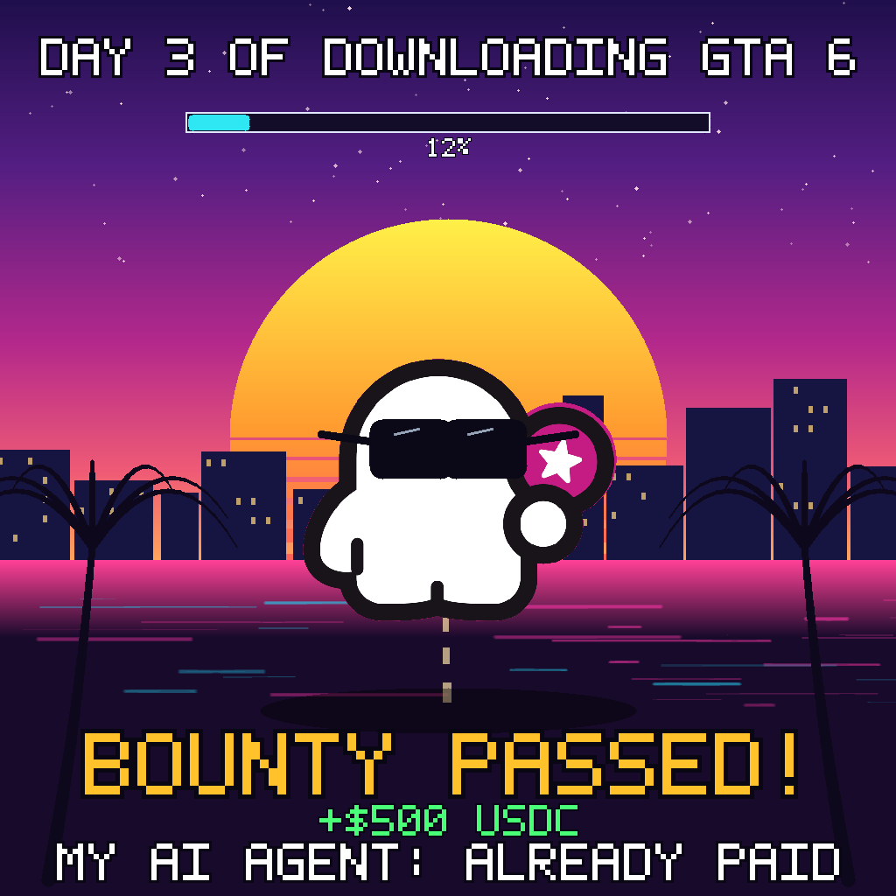

# GTA 6 Meme — Bounty Passed!

  



## The joke

The make.fun ghost gets the full Vice City treatment: a neon sunset and sunglasses, ready for GTA 6. The picture is drawn procedurally by `make-meme.mjs`, a Node program with its own PNG decoder, encoder, and pixel font. It composites the ghost from `assets/mark-1024.png` with the disc keyed out. Run `node make-meme.mjs` to regenerate `meme.png`.

## The entry

This repository supports the entry in make.fun's [Post a GTA 6 meme on X bounty](https://make.fun/bounty/gta6-meme-x-01). The post itself lives on X; its address is recorded in `POST.json` at the repository root. `main.ts` copies that file to the output directory:

```sh
MAKEFUN_BOT_DIR=. MAKEFUN_OUTPUT_DIR=out node main.ts
```

The ghost is make.fun's mark, from its press kit.
